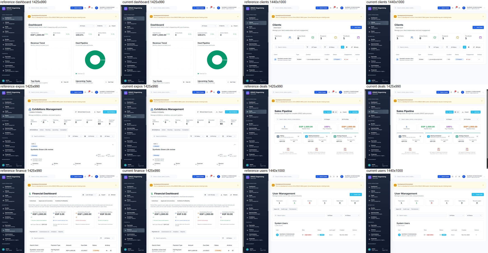
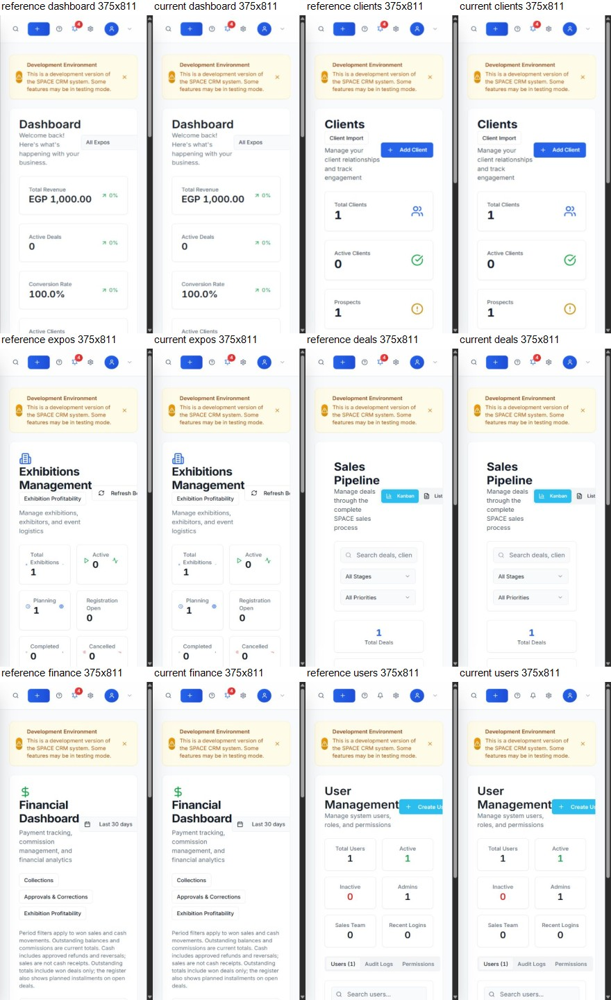
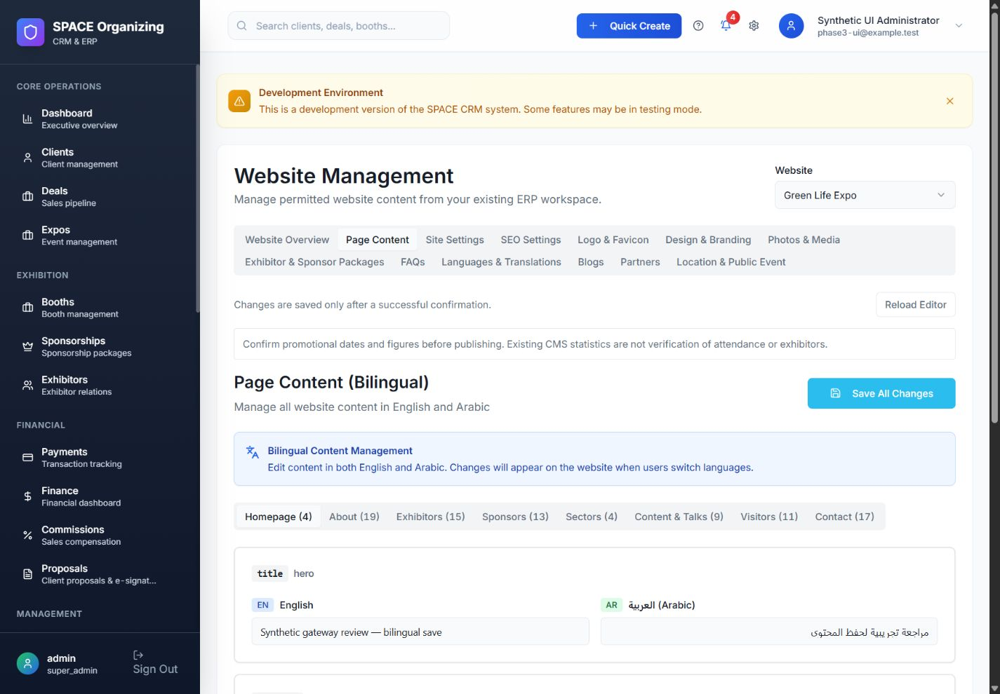
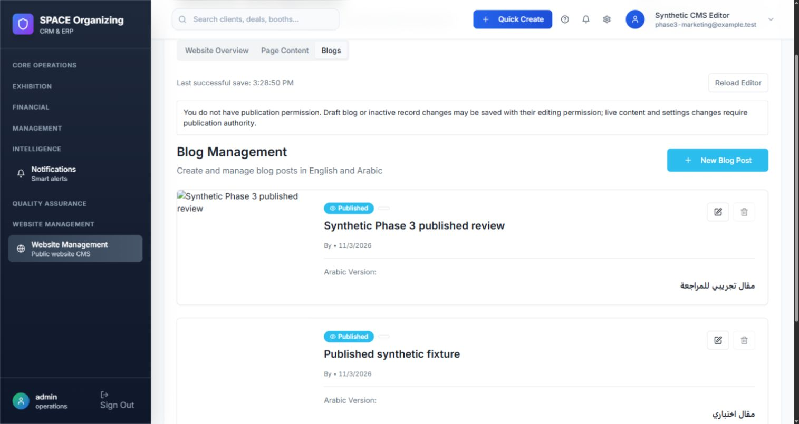
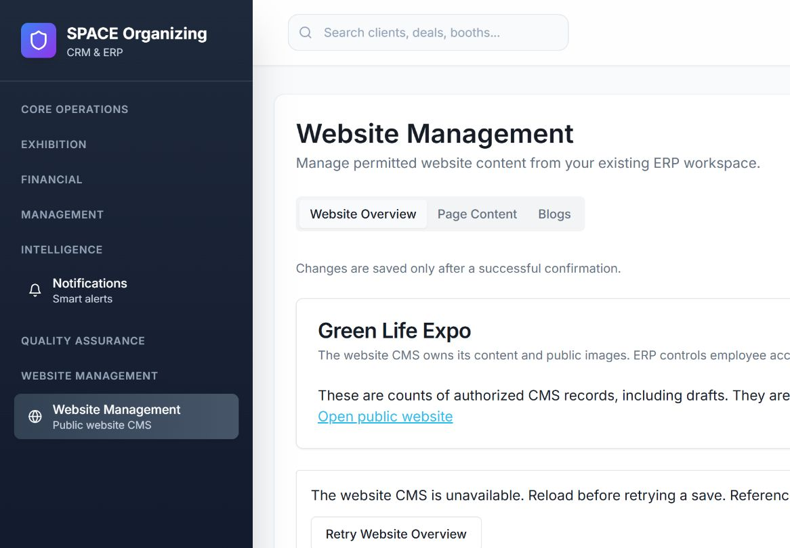

# Phase 3 — Website CMS in the existing ERP

## Contract verification before implementation

Verified ERP base: `80f37386ae1f8066f7c621d7d7609542a0d0d83e`; draft PR #2 remains unmerged. Verified website `main`: `080ea485b41f034d733f467981aa73ec17b8a6e9`. Its prior local migration branch has the same tree; no intervening website-main changes were found. Feature branches: ERP `codex/phase-3-cms-integration`, website `codex/phase-3-cms-gateway`.

The ERP policy defaults off, uses registered actions/overrides and an authentication epoch, and applies exhibition predicates before record scope. This phase must not activate operational flags or guess an operational event ID. A reviewed backend configuration binds one existing Green Life Expo website to an ERP exhibition; isolated tests use an explicitly synthetic exhibition.

Website contracts inspected: `backend/config/cms.php`, `backend/routes/web.php`, `backend/app/Http/Controllers/{ResourceController,UploadController,AuthController}.php`, `backend/app/Models/CmsRecord.php`, the CMS migration, React API adapter, all existing editor components, public hooks, router and providers. CMS IDs are UUIDs; ERP exhibition/user IDs are integers. These identifiers, databases, Laravel applications, keys, sessions and dependency trees remain separate.

| Existing editor | Authoritative data | Public consumers / concern |
| --- | --- | --- |
| Dashboard | Counts from content resources | Existing dashboard also fetches private submissions; do not import those cards into Phase 3 |
| Content | `page_content` | `usePageContent` currently collapses section/key identities; preserve page + section + key |
| Settings | `site_settings` | `useSiteSettings`, public page components; current public settings expose arbitrary keys |
| SEO | SEO settings in `site_settings` | SEO context and page hook; editor refresh must not change ERP metadata |
| Logo/favicon | Logo settings + `premium_logos` uploads | Favicon loader/public navigation; editor directly edits document favicon and must be isolated |
| Design | Color settings | Existing editable color fields; verify actual public bindings before claiming they work |
| Photos | `photos`, `premium_photos` uploads | `usePhotos` and public page images |
| Packages | `packages` | Public exhibitor/sponsor pages |
| FAQs | `faqs` | Public FAQ content |
| Language | `translations`, language settings | Website language context changes root direction; do not mount it in ERP |
| Blogs | `blogs` | Blog list/detail; stored HTML currently rendered without sanitization |
| Partners | `partners`, `partner_logos` uploads | Public partner components |
| Location | Public event/map settings | Public location/contact presentation; validate map embeds locally |

Existing API response contract is `{data,count?,error?}` through a Supabase-style query adapter. Server errors contain `message` and Laravel `errors`; the old adapter discards field details. Existing list endpoints cap at 1,000 and have no offset; editors require pagination and conflict-aware saves. Existing admin editors contain sequential multi-row saves, so partial failures must remain visible and success must not be fabricated. Uploads currently accept image buckets and return `/storage/...`; existing asset paths must remain valid.

Both applications use React 18 and similar UI primitives, but ERP uses React Router 7/Zod 4 and the website Router 6/Zod 3. Reuse editor logic and fields with ERP primitives and a local compatibility provider; do not import website App, AdminLayout, global CSS, language/SEO/auth providers, or a second router.

### Locked visual baseline

Before any implementation source edits, twelve screenshots were captured from the actual Phase 2 ERP at desktop 1440×1000 and mobile 390×844: Dashboard, Clients, Expos, Sales, Finance and User Management. They use an independent `space_crm_phase3_ui_test` database with visibly synthetic fixtures, not operational users or records. Artifacts: `outputs/phase3-visual/before-{desktop,mobile}-{dashboard,clients,expos,deals,finance,users}.jpg` in the task workspace. The baseline includes pre-existing responsive limitations; no global layout/style fixes are authorized. Final comparisons and CMS screenshots will be recorded after implementation.

## Implementation boundaries

Employee browser → existing ERP React shell → session/CSRF/auth-version protected ERP Laravel gateway → independently authenticated, short-lived request-bound website API → existing website CMS database. No browser service token, website administrator impersonation, cross-origin admin cookie or iframe administration. An isolated HTML preview frame is permitted solely for untrusted rich-text preview.

The website remains the content and public-media authority. ERP remains the employee, permission and exhibition authority. Publication privileges are explicit: live settings/content changes require publication authority; an editor may edit an unpublished blog without obtaining unrelated sales/finance/user permissions. Existing financial calculations and all ERP business pages are out of scope for changes.

Operational release, migrations, explicit binding review, credential provisioning and flag activation require a separate deployment authorization. Rollback must preserve website records/UUIDs/assets and additive security/audit data. Existing public routes and article slugs remain unchanged. No submissions pipeline, buyer/visitor/hosted-buyer/matchmaking implementation is included.

Further implementation, tests, browser evidence, file inventory and release prerequisites are appended as verified; an editor's mere presence is not evidence of working integration.

## Implemented architecture and ownership

The browser uses only the ERP's same-origin session and CSRF API. The ERP checks the active authentication version, registered action permissions and the bound exhibition before it signs a short-lived request. Website Laravel verifies the signature, request method/path/body, issuer, audience, key ID, site, integer exhibition, expiry and a single-use nonce independently. It then checks resource/action/publication authority again. The service is stateless: no website administrator login, shared application key, session cookie, iframe administration, operational-data copy or browser-held service credential.

Website MySQL remains authoritative for page_content, site_settings, translations, packages, faqs, photos, blogs and partners, retaining their UUIDs and historical asset URLs. ERP MySQL remains authoritative for integer staff/exhibition IDs, permissions, exhibition memberships and every CRM/financial record. The only website migration adds cms_delegation_nonces and cms_gateway_audits. It neither rewrites CMS content nor imports ERP business tables. ERP requires no Phase 3 database migration.

### Resource and field compatibility

The identical config/cms-contract.json files define twelve resource boundaries and an explicit public settings allowlist. Settings are partitioned into general, SEO, branding, location and language families. General Settings aggregates only families the employee may read, and saves back through each row's original resource/version/permissions. The existing twelve editors retain their fields and dialogs using ERP primitives and a local adapter; provenance.json records their source revision/hashes. The overview deliberately excludes contact submissions, visitor registrations, users and operational attendance claims.

Existing record fields, UUID identities, composite page/section/content keys, slug URLs, English/Arabic values and public-media paths are retained. Relative image URLs display against the configured public website origin and return to their historical relative form on unchanged saves. The Content editor no longer displays English as if it were a stored Arabic value. Public page-content lookups support qualified section.key and section_key aliases; duplicate bare keys are not silently selected. Blog Arabic content falls back to English only when its Arabic content is empty.

No whole application, website global CSS, language provider, SEO provider, theme configuration or second router is mounted in ERP. Website branding/public metadata code belongs solely to the website. ERP editors do not modify the ERP document title, favicon, language, direction or CSS variables. Blog HTML preview uses an opaque sandbox without scripts or same-origin privileges. The existing Google map preview uses a separate trusted Google Maps URL and sandbox suitable for its cross-origin scripts; it is not a CMS HTML preview.

### Permissions and publication

Phase 2 remains the authority: website.view plus resource-family view/create/edit/delete/publish; media also has upload. The CMS feature and granular-authorization flags are checked even for Super Admin. Default role grants are Super Admin only; CMS-only employees use explicit overrides and exhibition membership without gaining CRM/finance/user privileges. Settings/content/translations are live resources and require publication authority for mutation. Blogs and active-flag resources support draft/inactive edits with editing authority; changing or deleting a live record, or activating/publishing it, also requires publication authority. There is no invented approval/version-history or scheduling engine.

The site configuration contains one explicit reviewed website-to-exhibition association. No operational exhibition ID is inferred from names or sample data. Current legacy CMS content is site-wide and shared by permitted staff within that bound exhibition; it has no invented owner/team columns. Future exhibition websites need explicit independent bindings and content scopes before activation, rather than cloning or reassigning existing rows silently. This is a multi-event integration boundary, not a completed multi-event editorial migration.

### Integrity, service limits and media

Writes target one UUID or a complete configured unique identity. Updates/deletes require an optimistic full-row version under a database row lock. Conflicts return 409, preserve the earlier save and require reloading; the browser never retries uncertain writes. Same-row translation autosaves serialize and use the preceding response's version; current typing is kept locally rather than overwritten by stale responses. Unchanged rows are skipped. Multi-row original Save All operations remain sequential, not one atomic form transaction: earlier successful rows can persist if a later row fails, and the error banner explicitly says so. Shared location-setting metadata is preserved instead of reclassifying contact fields.

Requests are bounded to 4 MiB JSON, 5 MiB image and 8 MiB responses; reads paginate and adapt down on response-size rejection, with an explicit 10,000-row editor boundary. Read retries are bounded to two attempts with fresh nonces; writes/uploads get one attempt. Redirects are disabled, TLS verification stays enabled, and HTTP is accepted only for configured loopback local/testing environments. Web-server/PHP body limits and clock synchronization still require staging verification.

Website record writes and successful audit entries commit together. Correlation IDs connect ERP audit_logs with website CMS audits without storing content, service tokens or signatures. A filesystem upload cannot be part of the MySQL transaction: an interrupted save may retain an unreferenced file. It is safer to retain that file than delete a possibly referenced historical asset. Original UI record deletion retains physical assets. The internal cleanup operation checks fixed CMS fields, including decoded HTML/URL/JSON references, before deleting an unreferenced image. It is not exposed as a general browser filesystem API. Expired nonce pruning is an explicit bounded cms:prune-nonces command; schedule it only as part of an approved release and retain audit history.

Image uploads verify actual MIME and dimensions, allow only fixed image buckets, use generated UUID names, and reject executable formats including SVG. Public serving is restricted to known buckets/image extensions and sends nosniff. The website's auto-registered private local-disk route was disabled because it conflicted with public /storage image routes; public media uses the existing public disk and streamed responses. No website code references signed private local-disk URLs; ERP private attachments are untouched. Production storage/CDN behavior requires runtime verification.

Public APIs always apply public projections, including with a website admin session: only allowlisted settings, active records and published/non-future blogs. Legacy HTML is sanitized on read without rewriting stored content. Safe text formatting is preserved while scripts, event handlers, unsafe URLs and active markup are removed. URL/map validations also cover legacy public projections. Legacy session-based CMS writes/uploads are rejected while the gateway is enabled, avoiding simultaneous unversioned writers; old admin read endpoints remain separate. Submission/admin-user workflows are not integrated or changed in this phase.

Optional public color bindings are behind CMS_PUBLIC_BINDINGS_ENABLED=false by default, because historical editor values were not applied by the original public frontend. Reviewed activation can use validated historical HSL/hex values. No stylesheet, font, Tailwind configuration, layout component or existing public structure was redesigned. Unverified promotional figures in existing content must be reviewed by the event owner before publication; CMS counts do not confirm participation.

## Verification completed locally

- Full isolated ERP Laravel suite: 141 tests, 2,107 assertions, passed (350.32 seconds). Final targeted CMS rerun: 9 tests, 54 assertions, passed. Final CI verification is recorded below.
- Final website isolated Laravel suite: 35 tests, 245 assertions, passed.
- ERP frontend: 16 tests passed, covering the previous authorization checks, resource mapping, pagination bounds, serialized versions, conflicts, unchanged saves, shared-setting metadata and locked design sources. All 27 sidebar destinations (26 original plus Website Management) resolve.
- Website frontend: 5 tests passed, including source preservation, section-key binding, stable SEO effects and validated color normalization.
- TypeScript checks and production builds passed in both repositories during implementation; final-head results are recorded below. Existing bundle-size/old Browserslist warnings remain; dependencies were not upgraded.
- PHP Pint could not run in this Windows environment: PHP reports is_readable/is_writable false for accessible workspace files. No filesystem permissions were weakened. PHP syntax/testing remains mandatory; final CI runs Linux checks.

### Actual browser evidence

Two separate synthetic browser databases were created: space_crm_phase3_ui_test and green_life_expo_phase3_ui_test, distinct from both disposable PHPUnit databases and both operational databases. Only the ERP synthetic staff login was used; the website browser database has no administrator user. Real HTTP saves traversed ERP React → ERP Laravel → signed website Laravel → website MySQL.

Verified browser saves: bilingual page content persisted after reload and appeared on the English/Arabic public home page; general settings; SEO; HSL branding; logo upload with a publicly rendered PNG; photo alt metadata with its historical URL retained; package dialog; FAQ creation; bilingual translation creation; bilingual blog draft then publication and Arabic public slug rendering; partner dialog; event location settings. Safe blog formatting survived while the injected test script was absent after save. These are synthetic editorial fixtures, not verified event partners, figures, dates or business transactions.

The initial pre-edit twelve screenshots remain in the task outputs. Browser viewport application and early-loading captures were then independently checked: final comparisons were recaptured in one controlled browser tab against an archived source snapshot of the verified Phase 2 commit, using the same isolated ERP database. Six desktop and six mobile pairs cover Dashboard, Clients, Exhibitions, Sales, Finance and User Management. Matched page pairs have the same rendered dimensions (desktop 1440×1000 or 1425×990 according to scrollbar state; mobile 375×811). No unintended layout/style difference was observed. Existing mobile clipping is present in both versions and was not redesigned. This is browser comparison evidence, not a claim of exhaustive pixel equivalence.

Artifacts in the task workspace outputs/phase3-visual: reference-{desktop,mobile}-{dashboard,clients,expos,deals,finance,users}.jpg, current-* equivalents, comparison-desktop.jpg, comparison-mobile.jpg, cms-content-saved.jpg and public-arabic-saved.jpg. Automated source checks independently compare every original ERP page, UI primitive, unaffected layout and stylesheet against Phase 2, and website styles/primitives/header/footer/Tailwind against website main. Only the authorized Website Management sidebar entry is added; original names/order/style stay intact.

### Operational preservation

Read-only PDO transactions hash every sorted row in both operational databases without bootstrapping either Laravel app. File fingerprints cover ERP private storage and website public media/static images. The initial and subsequent comparison match: ERP 37 tables/3 files; website 19 tables/2 files. No record values or credentials are included in this report. Final comparison is repeated before delivery. No operational migrations, seeds, resets, schedulers or backup jobs were run.

## Release dependency, cutover and rollback — not executed

1. Review Phase 1/2 and both Phase 3 draft PRs together. ERP Phase 3 targets the verified Phase 2 branch; website Phase 3 targets main. Do not merge Phase 3 ahead of its ERP authorization dependencies.
2. Verify deployed commits, PHP versions, domain/proxy topology, public storage/CDN headers, database engines, real content/asset inventory and the actual ERP exhibition binding. Back up each database and its authoritative files independently; rehearse restore in isolated staging. Review promotional claims and bilingual content with the event owner. Operational infrastructure has NOT been verified by this local work.
3. Schema first on the website, under a separately authorized deployment: apply only the additive Phase 3 security migration. The previous application does not reference these new tables, so it remains compatible. Never roll back historical CMS migrations, drop business tables, reseed, replace storage or copy the ERP schema into the website database.
4. Deploy website compatibility/security code and ERP Phase 3 code with CMS flags off. Keep existing application keys/session stores separate. Configure one strong backend-only gateway secret, key ID, exact HTTPS endpoint/origin, audience and the reviewed matching exhibition ID on both sides. The shared service secret is not an application key. Do not place it in Vite variables, browser storage, CI secrets for tests or source control.
5. Verify Phase 2 membership/action overrides and synthetic staging staff. Enable the website gateway to fence old CMS writers, smoke-test signed reads with the matching ERP binding, then enable ERP CMS access. Keep the optional public-branding flag off until its values/design parity are reviewed. Coordinate the short editorial handover window; the public site remains readable throughout. Use a documented key rotation window and synchronized clocks; claims already in flight expire within 30 seconds.
6. In staging, repeat the representative browser edits, upload/render, permissions/revocation, outage/recovery, financial regression and public English/Arabic checks. Validate real proxy body/time limits, public cache invalidation, nonces/audit retention and monitoring. Schedule the bounded nonce prune command as appropriate; monitor rejected signatures/conflicts without logging secrets. Approve production activation separately.
7. Rollback is flag/code based. Disable ERP CMS access first, stop new gateway writes, reconcile any uncertain write by correlation ID, retain content/UUIDs/assets/security/audit tables, and only then disable the website gateway if deliberately returning to the legacy editor. Do not enable both writers concurrently. Keep public allowlisting/HTML-safety fixes when possible; reverting to pre-security website code reintroduces known risks. Do not run migration:rollback as a normal feature rollback, delete newly uploaded files, or restore an old database over newly saved content.

## Remaining scope and readiness

Verified locally: the secure integration boundary, reused editorial resources, separate database/session ownership, synthetic browser saves and existing ERP visual/business regressions. Requires runtime verification: deployed data/infrastructure/backups, real exhibition binding, TLS/proxy/CDN/storage and clock/retention settings, editorial claim validation, accessibility/user acceptance across all supported devices, and operational key provisioning/activation. No production-readiness claim follows from local passing tests.

Phase 4 is not started. Its eventual submissions centralization can depend on this boundary but still needs separate design/authorization for source submission ownership, idempotency/deduplication, consent, qualifications and CRM/buyer/visitor routing. Nothing here automatically creates a client, exhibitor, deal, payment, hosted buyer or visitor business record.

### Additional browser checks

The CMS-only synthetic employee saved a draft with the publication switch disabled and received the original access-denied screen on direct Finance navigation. Website outage and Retry recovery were verified without reauthentication. Optional public branding was enabled only in the separate browser test environment, its validated CSS variables and saved SEO title were observed, and it was restored off. ERP branding remained isolated. Staff who have no dashboard permission use the authorized Website Management entry; the original default Dashboard landing/access-denied behavior was preserved. Physical asset cleanup requires an explicitly quiescent editorial maintenance window; it is not forwarded by the ERP browser gateway.

### Review evidence included in this PR

## Exact ERP file inventory

- `.github/workflows/erp-tests.yml`
- `backend/.env.example`
- `backend/app/Http/Controllers/AuthorizationController.php`
- `backend/app/Http/Controllers/WebsiteCmsController.php`
- `backend/app/Http/Middleware/AuthorizeOperation.php`
- `backend/app/Services/CmsGateway.php`
- `backend/app/Services/PermissionPolicy.php`
- `backend/app/Services/PermissionRegistry.php`
- `backend/config/authorization.php`
- `backend/config/cms-contract.json`
- `backend/config/cms_contract.php`
- `backend/config/cms_gateway.php`
- `backend/routes/web.php`
- `backend/tests/Feature/WebsiteCmsTest.php`
- `docs/PHASE-3-CMS-INTEGRATION.md`
- `docs/phase-3-evidence/cms-content-saved.jpg`
- `docs/phase-3-evidence/cms-outage.jpg`
- `docs/phase-3-evidence/cms-restricted-staff.jpg`
- `docs/phase-3-evidence/comparison-desktop.jpg`
- `docs/phase-3-evidence/comparison-mobile.jpg`
- `scripts/cms-ui.test.mjs`
- `scripts/verify-navigation.mjs`
- `src/App.tsx`
- `src/auth/access.ts`
- `src/cms/client.ts`
- `src/cms/context.tsx`
- `src/cms/editors/Blogs.tsx`
- `src/cms/editors/Content.tsx`
- `src/cms/editors/Design.tsx`
- `src/cms/editors/FAQs.tsx`
- `src/cms/editors/Language.tsx`
- `src/cms/editors/Location.tsx`
- `src/cms/editors/Logo.tsx`
- `src/cms/editors/Packages.tsx`
- `src/cms/editors/Partners.tsx`
- `src/cms/editors/Photos.tsx`
- `src/cms/editors/SEO.tsx`
- `src/cms/editors/Settings.tsx`
- `src/cms/editors/provenance.json`
- `src/components/layout/Sidebar.tsx`
- `src/contexts/AuthContext.tsx`
- `src/pages/WebsiteManagement.tsx`

## Exact Website file inventory

- `.github/workflows/ci.yml`
- `backend/.env.example`
- `backend/app/Http/Controllers/CmsGatewayController.php`
- `backend/app/Http/Controllers/ResourceController.php`
- `backend/app/Http/Controllers/UploadController.php`
- `backend/app/Http/Middleware/AuthenticateCmsDelegation.php`
- `backend/app/Http/Middleware/LimitCmsRequest.php`
- `backend/app/Services/CmsHtml.php`
- `backend/app/Services/CmsMedia.php`
- `backend/app/Services/CmsRecords.php`
- `backend/bootstrap/app.php`
- `backend/config/cms-contract.json`
- `backend/config/cms_contract.php`
- `backend/config/cms_gateway.php`
- `backend/config/filesystems.php`
- `backend/database/migrations/2026_11_03_000002_add_cms_delegation_security.php`
- `backend/routes/cms.php`
- `backend/routes/console.php`
- `backend/routes/web.php`
- `backend/tests/Feature/CmsApiTest.php`
- `backend/tests/Feature/CmsGatewayTest.php`
- `backend/tests/TestCase.php`
- `docs/PHASE-3-CMS-GATEWAY.md`
- `scripts/cms-public.test.mjs`
- `src/App.tsx`
- `src/components/PublicCmsBranding.tsx`
- `src/contexts/SEOContext.tsx`
- `src/hooks/usePageContent.ts`
- `src/hooks/usePageSEO.ts`
- `src/integrations/api/client.ts`
- `src/lib/cmsBranding.ts`
- `src/pages/BlogDetail.tsx`
- `src/pages/admin/Design.tsx`

## GitHub delivery verification

Local verification is reported above. GitHub Actions runs and both draft PR links are recorded after publishing the reviewed feature branches. No CI success is inferred from a local pass. Both PRs must remain draft and unmerged; activation requires the separate release prerequisites above.

## Final delivery verification — 3 November 2026

- [ERP draft PR #3](https://github.com/Omar-Fouad-Organization/Space-Crm-erp-system-NEW/pull/3), branch codex/phase-3-cms-integration, targets codex/phase-2-granular-authorization. Phase 2 remains its unmerged dependency.
- [Website draft PR #2](https://github.com/Omar-Fouad-Organization/Premium-website/pull/2), branch codex/phase-3-cms-gateway, targets main. These are a coordinated release; neither PR was merged or deployed.
- [ERP GitHub Actions](https://github.com/Omar-Fouad-Organization/Space-Crm-erp-system-NEW/actions/runs/41674210282): frontend and Laravel jobs succeeded. Actual Linux log: 141 tests passed, 2,107 assertions, 66.28 seconds. Published code commit: 5cc8832d8846cf987a21d71ace0762419793f336.
- [Website GitHub Actions](https://github.com/Omar-Fouad-Organization/Premium-website/actions/runs/41674511272): frontend and Laravel jobs succeeded. Actual Linux log: 35 tests passed, 245 assertions, 1.96 seconds. Published code/CI commit: 0cf39fa075848c69328611ceb8f0a82b0d5297a0. The first website CI run caught a test-account username mismatch; the workflow now consistently uses website_ci and its rerun passed. No operational credentials were used.
- Final local TypeScript checks and production builds succeeded for both apps. ERP frontend 16 tests and website frontend 5 tests passed. Browser evidence and local Laravel results above remain distinct from GitHub Actions results.
- After restarting the existing local MySQL services between chat turns, the final read-only comparison still matched all original operational fingerprints: ERP 37 tables/three private files; website 19 tables/two public/static files. No operational schema/record/asset or flag changes occurred.
- GitHub publication used the connected app because the local credential helper was unavailable. Uploaded Git trees were required to match the locally tested trees exactly before any branch was published. Final documentation-only follow-up commits receive their own CI run; the PR checks show the current head status.

Recommendation: **Ready for Review**, with production activation blocked on the separately authorized staging/deployment prerequisites above. This is not authorization to merge, deploy, activate flags or begin Phase 4. No Phase 4 implementation was performed. The original dashboard landing remains permission-gated; a CMS-only employee uses the Website Management navigation entry. Existing mobile clipping and multi-row partial-save behavior are documented rather than hidden or redesigned.
