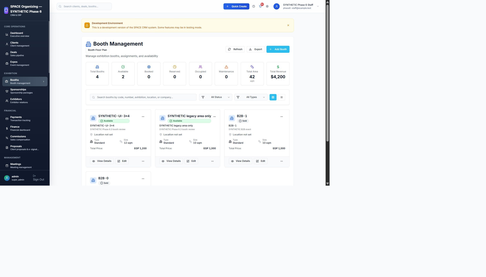
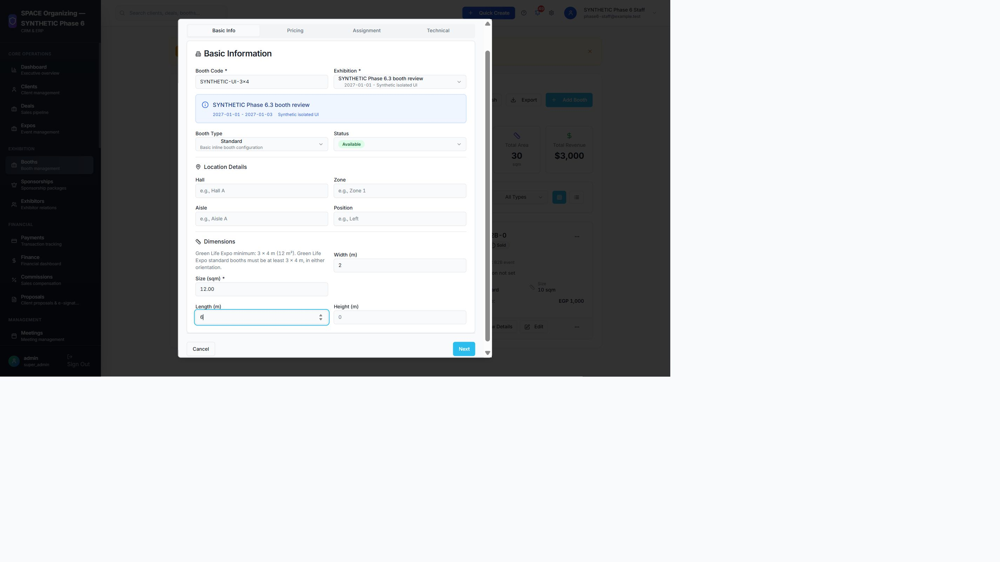

# Phase 6.3 — Security and event-scoped booth policy

## Executive summary

Targeted dependency remediation and additive event-scoped booth validation are implemented on the existing Phase6 draft branch. Existing framework majors, layouts, financial services and operational records are preserved. Verification also found older deal-detail placeholders and stored/public content requiring review; this is not a production go-ahead.

## Dependency changes

| Audit metric | ERP before | ERP after | Website before | Website after |
|---|---:|---:|---:|---:|
| Composer advisory matches |7|0|7|0|
| Full npm vulnerable packages |9 moderate|0|25 (16 high,9 moderate)|0|
| Runtime npm vulnerable packages |0|0|15 (11 high,4 moderate)|0|
| Historical npm package/advisory pairs |2 moderate|0 current feed matches|54 (27 high,25 moderate,2 low)|0 current feed matches|

ERP Symfony http-foundation/http-kernel/routing 7.4.22 →7.4.23; yaml **8.1.10 →8.1.11**. Laravel remains12.70.2. Compatible npm transitive patches and targeted minimatch >=7 <11.0.1 override to11.0.1. Old minimatch3 API is not overridden. No React/framework blanket update. Node24 supports the selected tool chain. Scope/usage/parent edges and exact before/after versions are in the complete inventory.

## Business rule and ownership

`BoothFootprintPolicy` enforces shorter side>=3m, longer>=4m, rounded area>=12m² for explicitly bound events. 3×4,4×3,4×5 accepted;2×6,3×3,2.5×5, missing dimensions and3×4 claimed16m² rejected. Width/depth have at most2 decimals; Brick BigDecimal multiplication uses HALF_UP to2 decimals (3.01×4.01=12.07). Client area must match; no floating-point commercial calculation is introduced. No ordinary checkbox, custom booth label, attributes or claimed legacy version bypasses enforcement. No exception policy has been invented.

Canonical nullable `footprint_width_m`, `footprint_depth_m` use DECIMAL(15,2) storage (validated0.01–9999.99); `footprint_policy_version` is server assigned. Existing JSON width_m/length_m hints remain untouched and are not promoted into verified dimensions. Existing size_sqm is never backfilled. Booth/exhibition keys remain integer FKs (UI transport strings), not UUID replacements.

`exhibition_booth_policies` has exhibition_id primary/restrict FK, code, activation watermark, reviewed_by restrict FK, encrypted approval evidence and activation timestamp. Binding is by exact exhibition FK, never name. Identically named other exhibitions retain their existing positive-area behavior. New booths in a bound event must comply; existing same-event booths at activation watermark remain legacy for unrelated edits. Moving in from another event is not grandfathered. Material geometry/event changes are rejected if status is nonavailable or any deal references the booth. A future reviewed commercial-change workflow would be required; none is invented here.

Activation command: `php artisan booths:configure-green-life-policy VERIFIED_EVENT_ID --reviewed-by=ACTIVE_SUPER_ADMIN_ID --reason="Recorded event-owner approval reference"` is a read-only dry run. Add `--activate` only in a separately authorized process with `BOOTH_POLICY_CONFIGURATION_AUTHORIZED=true` after exact environment/event approval. Default flag=false. Existing bindings cannot be overwritten. Reviewer must be active super_admin; reason10–1000 characters, encrypted at rest. Only newly created isolated synthetic event was bound; **operational Green Life ID and commercial approval remain unverified and unbound**.

## Enforcement and exact impact map

- `backend/app/Services/BoothFootprintPolicy.php`: dimensional, legacy and commercial protections; locks event/policy inside original save transaction.
- `backend/app/Services/CrmService.php`: canonical field validation, policy invocation and read projection; no changes to deal/pricing/tax/installment/receipt/commission algorithms. Existing imports call CrmService::save and cannot bypass it.
- `backend/config/crm.php`, `backend/config/booth_policy.php`, `backend/.env.example`: fields and default-off configuration authority.
- `backend/database/migrations/2026_11_08_000001_add_event_booth_footprint_policy.php`: additive nullable columns and policy table. Original config-driven schema already creates dimension columns on fresh installs; guarded addition ensures fresh/upgrade schema compatibility without editing old migrations.
- `backend/app/Console/Commands/ConfigureGreenLifeBoothPolicy.php`: reviewed explicit binding, locking, encrypted reason, audit.
- Active `src/components/forms/CreateBoothDialog.tsx` and `EditBoothDialog.tsx`: reuse original width/length/area, tabs and light primitives; computed area, policy feedback, no bypass. Requested `components/booths/CreateBoothDialog.tsx` was inspected but is dormant, so was not falsely treated as the active form.
- `src/services/laravelClient.ts`: canonical dimensions projected into legacy display fields without fabricating missing values. `supabaseService.ts` adds authoritative price type only; data still uses Laravel.
- `src/lib/boothFootprint.ts`, `boothEditPricing.ts`: exact centimetre footprint calculation, preserve authoritative inventory total on unrelated edits (including fractional per-m² rates). UI pricing bug correction does not reprice any saved deal.
- `src/pages/BoothsPage.tsx`: remove exact duplicate edit-dialog mount only; original remaining dialog and full refresh callbacks retained. Shared CSS, sidebar/header/design tokens unchanged. Local edit-dialog wrapping fixes320/360 overflow; desktop styling unchanged.
- New policy/concurrency/request tests and extended test-only reservation worker; full old suites retained. Two historical source-lock tests normalize only the exact deleted redundant mount; all other page/layout bytes still compared.
- Dependency manifests/locks, `.github/workflows/erp-tests.yml`, new booth tests and evidence/docs. No website business backend edit beyond request regression tests/dependency lock.

## Migration, concurrency and rollback

Future approved release sequence: verified backups/files/keys and isolated restore rehearsal first; record exact current schema/SHAs; apply additive migration schema-first while policy remains unbound; verify nullable historical dimensions and unchanged financial fingerprints; deploy paired code; smoke-test synthetic data; approve real event ID with event/commercial owner; activate binding in authorized restricted console process; revoke configuration flag afterward. This report does not authorize these steps operationally. Both fresh migration test installs and existing isolated UI schema upgrade passed.

Previous app can tolerate added nullable columns/table before activation, but **old code cannot enforce an activated policy**. On code rollback after activation freeze booth create/update/import and related allocation changes, preserve schema/bindings, then restore compatible enforcement or obtain a separately reviewed rollback procedure. Do not run migration down after real policy/dimension writes; it deletes policy evidence/dimensions and destroys enforcement. Restore only in controlled recovery with reconciled records, never reset business tables. InnoDB FK/PK and existing booth-name unique constraints retained. Event/policy/booth/deal locking and existing transaction retries serialize activation, geometry and allocations; real child-process reserve/resize race passed with one coherent tuple and unchanged deal amount.

## Financial/data preservation

Full Laravel suite: **234 passed /2792 assertions** (217/2699 original tests retained). Policy tests snapshot deals/payment_schedules/payments/invoices/commissions before/after legacy edits and rejected resize; identical snapshots. Existing sold/reserved booth protections retained; no new invoice/payment/reservation is produced by dimension edits. Reserve/resize race checks one deal, original amount/currency, coherent12/3/4 or20/4/5, reserved status and zero payments/invoices.

Read-only saved local baseline fingerprints match: ERP37 tables/3 private files, website19 tables/2 assets. Original synthetic row preservation passes across exhibitions1,clients2,booths1,deals1,payment_schedules1,payments0,commissions1,intake_submissions8,buyer_organizations1,registration_controls5. These are specifically authorized local baselines, not a remote-production certification. New synthetic UI event/booths are separate additions; original10m² sold allocations remain unchanged.

## UI and test results

Local: ERP234 Laravel/2792 assertions; **28 frontend tests** (25 original +3),38 navigation destinations; TypeScript and production build passed. Website88 Laravel/577 assertions,18 frontend,TypeScript/build passed. Real request/nonce/signature/invitation/revocation/private-file/queue/B2B/financial suites retained. Complete local logs in evidence.

[238 viewport measurements](phase63-evidence/viewport-metrics.json):17 authentication/buyer/exhibitor page families ×7 widths ×2 languages, exact innerWidth/height, correct hash and page marker, correct RTL/LTR;0 overflow. ERP create and edit dialog each measured at320,360,375,390,414,768,1280 actual CSS pixels;0 final internal overflow. Initial Windows viewport overrides were scaled, so only exact same-origin iframe measurements are final evidence; no global application CSS modified. Browser summary distinguishes loaded views and actual writes from automated workflow coverage. Registration remained closed; CMS browser check reached login only; no authenticated CMS editor browser session is claimed.

Build warnings remain existing large chunks and static/dynamic import split warnings; not silently claimed clean performance. No full accessibility certification or deployed security assurance is implied.

## Evidence and audit method

Verified on 8 November 2026 in isolated local MySQL databases. [Advisory records](phase63-evidence/advisory-records.json) retain every original package/advisory match (identifier, original/new version, range, supplied severity, directness, scope, usage, exposure, compatibility and disposition). [Dependency inventory](phase63-evidence/dependency-inventory.json) records every locked package, original/new version, root constraints and requires edges, including nested npm locations and optional packages. Runtime-lock classification is not browser exploitability: some build tools were already declared production dependencies. No package was moved out of scope to hide findings. Composer null severities remain unspecified, never invented.

Fresh raw full and runtime npm audits and Composer locked audits are in [phase63-evidence](phase63-evidence). Phase6.2 npm counts are package/advisory pairs; npm CLI summary counts are vulnerable packages including propagated chains, so they are different metrics. All original advisory matches remain individually traceable. Zero feed findings is time-bound dependency evidence, not a guarantee of absence of vulnerabilities. No live exploit testing occurred. New host/forwarded/path tests exercise the Laravel pipeline; they are compatibility regressions, not claimed exact CVE reproductions.

Reproduce with Node24/PHP8.4, `npm ci`, `npm audit`, `npm audit --omit=dev`, `composer install`, `composer audit --locked --format=json`, then frontend/type/build and sequential Laravel tests. CI runs full npm, runtime npm and full locked Composer audits with nonzero results failing the job. No ignore/suppress/force flags. The four Symfony updates were resolved and installed by Composer with exact targets/minimal changes; npm locks were generated by npm and verified by actual npm ci. Windows Composer/Pint filesystem limitations required a workspace staging copy for Composer installation; no environment secrets were copied and no hand-edited lock entries were used. Pint could not write through this host PHP filesystem boundary; no successful Pint result is claimed.

Primary vendor evidence includes [Symfony path parsing](https://github.com/symfony/symfony/security/advisories/GHSA-3h27-hjv7-fqjx), [Symfony trusted proxies](https://github.com/symfony/symfony/security/advisories/GHSA-xg2q-4rrq-657q), and [React Router mode-specific guidance](https://github.com/remix-run/react-router/security/advisories/GHSA-2w69-qvjg-hvjx). Each remaining vendor/advisory URL is retained in the advisory records. Reachability was assessed conservatively: Laravel uses the HTTP components; Symfony Security access_control is not assumed to be used; YAML has no identified application upload parser; declarative HashRouter/Routes is used, not a data router. Development parser/glob/build findings are build/CI exposure, not dismissed as harmless.

## Release and operational limits

**Ready for Independent Review — Remaining Software Findings. Production: NO-GO.** No merge, deploy, operational migration, data reset/backfill, real email/scanner activation, production event binding or Phase7 occurred. Existing draft PRs remain dependent and unmerged. Exact final commit and actual GitHub Actions conclusions belong in the draft PR delivery record; local results below are not Actions results.

Open findings: the old ERP deal-detail screen still renders hard-coded booth/payment/commission previews (A-101/36sqm/Hall1 and illustrative 30/40/30 schedule/5% commission), not authoritative relations. Its source was deliberately left unchanged in this targeted phase; do not use it as financial evidence. Read-only local CMS scan found one packages.features row with obsolete dimensions; no content records were edited. Public sponsor marketing includes an unverified 50M+ impressions claim; content owner must verify or remove it before release. Remote deployed content/infrastructure has not been inspected or certified. These findings are not caused by dependency patches, but remain review/release concerns.

All Phase6.2 infrastructure gates remain: positively identified isolated staging, HTTPS/proxy/cookie validation, real provider and SPF/DKIM/DMARC plus actual email receipt, deployed PDF scanner, operational private storage ACLs, queue/cache supervision and recovery, encrypted off-host backups and recovery/key rehearsal, privacy/retention approval, dependency-chain review and explicit release authorization. Synthetic checks do not clear any of these.
