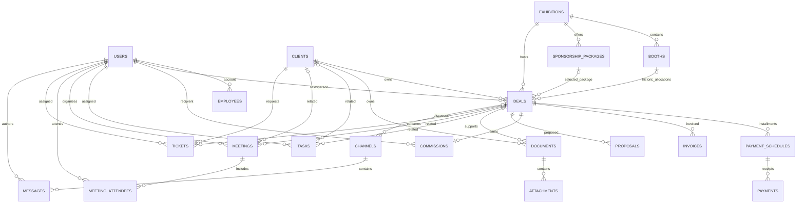

# SPACE CRM relationships

React uses a Laravel JSON API and an HTTP-only session cookie. MySQL stores all business records. The browser has no database credentials.

Most parent deletes use MySQL RESTRICT. A parent cannot be deleted while referenced by another business record. Deleting a meeting removes its attendee pivot rows. Documents with attachments cannot be deleted until those files are removed. Receipts, invoices, and commissions cannot be deleted through normal CRUD; an accounting reversal workflow is deliberately required before supporting financial reversals.

Every business record has a server-assigned creator. Audit history stores actor, action, record ID, and before/after values with password hashes removed. Audit record IDs and notification targets are historical references, not cascading business relationships.

Booth reservation/sale status is derived from live deals. Only one deal that is not lost/cancelled can reserve a booth. The backend locks the booth while checking this rule. Cancelling an unpaid deal releases its booth and zeroes a pending commission.

Deal creation with installments and commission generation is transactional. Installments must total exactly the deal amount when supplied at creation. Later installments cannot overallocate it. Receipt entries cannot exceed the installment balance; deals must be closed won before receipts are recorded. Approved/paid commissions lock financial relationships. Approval requires full receipt of the deal value.

Currencies are kept separate; no exchange-rate conversion is implied. Money uses MySQL DECIMAL(15,2) and exact server-side decimal arithmetic.

Roles are scoped by module, not by salesperson ownership. The installation represents one organization. The permissions matrix is defined in `backend/app/Services/CrmService.php` and verified for every role/module pair. Only the administrator manages accounts. Management cannot access HR records or account/HR audit payloads.
